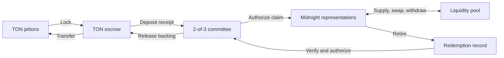

# Midnight–TON bridge

**Move tokens between TON and Midnight. Put bridged liquidity to work.**

A bidirectional token bridge with a built-in two-asset liquidity pool, a TypeScript SDK and a complete operator toolkit. Lock jettons on TON, use their representations on Midnight, then redeem them back to TON through a quorum-authorized return path.

[Quick start](#quick-start) · [Deployment guide](docs/deployment.md) · [SDK](#typescript-sdk) · [Starter app](https://github.com/AlphaCompute/midnight-ton-bridge-starter) · [Releases](https://github.com/AlphaCompute/midnight-ton-bridge/releases)

## Built for the complete round trip

- **Bridge in both directions.** Authenticated TON deposits, quorum-authorized Midnight claims, permanent retirement and verified TON recipient delivery.
- **Use existing tokens.** Configure compatible jetton masters with pinned wallet code and deterministic address verification. Bridging does not require issuer mint authority.
- **Supply liquidity and swap.** A two-asset Midnight pool with reserve-ratio checks, slippage bounds, 30 bps swap fees and secret-authorized LP withdrawals.
- **Integrate with TypeScript.** Build deposit messages, validate claims, redeem tokens, quote swaps and manage liquidity through one SDK.
- **Operate with visibility.** Durable transaction journals, signer limits, replay protection, trace-based recovery, accounting checks and Prometheus metrics.
- **Reproduce the results.** Contract tests, proof-backed transactions, public testnet evidence, CI and checksummed release bundles.

The public deployment connects **TON testnet and Midnight preprod**. Its end-to-end flow covers deposits, claims, liquidity provision, swaps, withdrawals and redemption. Explore the [deployment addresses](docs/standard-testnet-deployment.json), [transaction evidence](docs/standard-testnet-evidence.json) and [accounting snapshot](docs/standard-testnet-accounting.json).

## How it works



Each route pairs two allowlisted TON escrows with an immutable Midnight contract. Two committee signatures authorize each cross-chain mint or release. Route domains, token identities, recipients and amounts are bound into the authorization; operators verify finalized chain records and pinned contract configurations.

The contracts use **Compact** on Midnight and **Tolk** on TON. The jetton adapter interoperates with the unmodified TON reference wallet. Midnight representations are unshielded. See [architecture](docs/architecture.md) and the [security model](docs/security-review.md) for protocol details.

## Quick start

Use **Node 24**, npm, bash, curl, tar and shasum. Docker supplies local chain and proof services. Bootstrap supports Linux x86-64/ARM64 and macOS Intel/ARM64.

```sh
git clone git@github.com:AlphaCompute/midnight-ton-bridge.git
cd midnight-ton-bridge
bash scripts/bootstrap.sh
npm run check
```

Generate proof keys before deploying or sending Midnight transactions:

```sh
npm run compile:midnight -- --proof
```

The lockfile and bootstrap scripts pin the toolchain. Build checks detect stale Compact bindings, and `npm run manifest` records source and artifact hashes.

### Run locally

```sh
docker compose up -d
export BRIDGE_NETWORK=local
export BRIDGE_STATE_DIR="$PWD/.state/local-demo"
npm run deploy:midnight
npm run demo:local
npm run validate:local
```

The local demo exercises Midnight proofs and pool operations. TON execution and cross-chain authorization are exercised in the TVM/Compact test suite. Local services bind to loopback ports **19944** (node), **18088** (indexer) and **16300** (proof server).

### Deploy to testnet

```sh
export BRIDGE_NETWORK=preprod
unset MIDNIGHT_NETWORK BRIDGE_STATE_DIR
npm run prepare:testnet
docker compose up -d proof-server
```

Follow the [deployment guide](docs/deployment.md) to fund the generated wallets, initialize synchronization, configure token masters and deploy both sides of the route. Choose existing compatible masters or the explicit testnet token-issuance option.

On a freshly deployed route, run the complete flow and verify its results:

```sh
npm run demo:testnet              # route with explicitly issued testnet tokens
# Existing funded tokens: npm run demo:testnet -- --existing-balances
npm run verify:testnet
npm run reconcile:ton -- all
npm run check:route
```

Keep `.state` private and preserve transaction journals between runs. For an interrupted transfer, use the [reconciliation procedure](docs/operations.md) before resubmitting. Network configuration and the production release procedure are covered in the [deployment guide](docs/deployment.md).

## TypeScript SDK

```ts
import {BridgeClient} from '@alphaton/midnight-ton-bridge/client';

const bridge = new BridgeClient(config, transport);
const body = bridge.depositMessage(
  0,                    // asset index
  1000n,                // integer base units
  midnightRecipientHex,
  tonSender,
  1n,                   // query ID
);
// Send body to the sender's verified jetton wallet.
```

`config` supplies the network (`local` or `preprod`), route domain, Midnight contract address, two TON escrows and three committee public keys. `transport` implements `call(circuit, args): Promise<string>`. Use finalized chain readback to confirm delivery.

| Action | SDK methods |
| --- | --- |
| Bridge into Midnight | `depositMessage`, `claimDigest`, `claim` |
| Bridge back to TON | `redeem` |
| Trade | `quote`, `swap` |
| Provide liquidity | `addLiquidity`, `removeLiquidity` |
| Verify token integration | `validateAssets`, `verifyAsset`, `referenceWallet` from the package root |

Install the SDK tarball from the [release bundle](https://github.com/AlphaCompute/midnight-ton-bridge/releases), or start with the [standalone notes app](https://github.com/AlphaCompute/midnight-ton-bridge-starter). The starter includes a pinned SDK package and runs with `npm ci`, `npm test` and `npm start`.

### Liquidity

Bridge backing and pool liquidity are accounted for separately. TON deposits back the Midnight representations; LPs supply those representations to the pool. Redemption releases the corresponding TON backing.

The first LP sets the initial reserve ratio. Subsequent deposits follow that ratio, and withdrawals use a private LP secret. Swaps retain a **30 bps fee** in the pool. Amounts remain integer base units across both chains. See [pool mechanics](docs/architecture.md) and [operations](docs/operations.md) for configuration and LP procedures.

## Operations

```sh
npm run check:route       # Pins, backing, circulation and journal status
npm run monitor           # Persistent health checks and metrics
npm run reconcile:ton -- all
```

The monitor exposes loopback `/healthz` and `/metrics` endpoints, persists failure state and detects stale checks. Linux service templates and Prometheus alert rules are included in [infrastructure/monitor](infrastructure/monitor).

Operators have per-transfer and daily signing limits, stop files and durable equivocation protection. Recovery binds to the original pending instruction and a verified failure trace. See the [monitoring guide](docs/monitoring.md), [operator runbook](docs/operations.md) and [transfer recovery guide](docs/standard-recovery.md).

## Documentation

| Guide | Contents |
| --- | --- |
| [Deployment](docs/deployment.md) | Local setup, public testnet, token registry and production release procedure |
| [Architecture](docs/architecture.md) | Contracts, authorization, representations and pool design |
| [Operations](docs/operations.md) | Wallet state, signing, reconciliation and recovery |
| [Monitoring](docs/monitoring.md) | Health endpoints, metrics and service installation |
| [Security model and review](docs/security-review.md) | Trust assumptions, implemented protections and review findings |
| [Validation](docs/validation.md) | Contract tests, proof execution and deployment evidence |
| [Benchmarks](docs/benchmarks.json) | Measured public-testnet call durations |
| [Release packaging](docs/delivery-artifacts.md) | Source, SDK, starter, walkthrough and checksums |

## License

[Apache-2.0](LICENSE). Vendored TON reference contracts retain their [MIT license](contracts/ton/reference/LICENSE).
