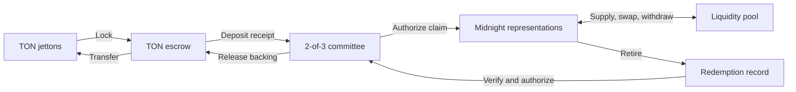

# Midnight–TON bridge

**Move tokens between TON and Midnight. Put bridged liquidity to work.**

A bidirectional bridge with a two-asset liquidity pool and TypeScript SDK. Lock jettons on TON, use their representations on Midnight, then redeem them back to TON.

[Quick start](#quick-start) · [Deployment](docs/deployment.md) · [SDK](#typescript-sdk) · [Starter app](https://github.com/AlphaCompute/midnight-ton-bridge-starter) · [Releases](https://github.com/AlphaCompute/midnight-ton-bridge/releases)

- **Existing tokens:** compatible jetton masters, verified wallet code and no issuer mint authority required.
- **Built-in liquidity:** supply assets, swap with slippage bounds and earn pool fees.
- **Operator tools:** transaction journals, signer limits, recovery, accounting checks and Prometheus metrics.

The **TON testnet ↔ Midnight preprod** deployment has completed the full deposit, claim, liquidity, swap, withdrawal and redemption flow. See [addresses](docs/standard-testnet-deployment.json), [transaction evidence](docs/standard-testnet-evidence.json), [accounting](docs/standard-testnet-accounting.json) and a live [stuck-deposit recovery](docs/standard-testnet-recovery-evidence.json).

## How it works



Each route connects two allowlisted TON escrows to an immutable Midnight contract. A **2-of-3 committee** authorizes claims and releases after verifying finalized chain records. Authorizations bind the route, token, recipient and amount.

Contracts use **Compact** on Midnight and **Tolk** on TON, with support for the unmodified TON reference jetton wallet. Midnight representations are unshielded. See the [architecture](docs/architecture.md), including its [scope and trust model](docs/architecture.md#scope-and-trust).

## Quick start

Requires **Node 24**, npm, bash, curl, tar, shasum and Docker. See [supported platforms and toolchain details](docs/deployment.md#build-from-a-clean-checkout).

```sh
git clone git@github.com:AlphaCompute/midnight-ton-bridge.git
cd midnight-ton-bridge
bash scripts/bootstrap.sh
npm run check
npm run compile:midnight -- --proof  # Proving keys for Midnight transactions (~30 min, several GB of RAM)
```

`bootstrap.sh` downloads the checksum-verified Compact compiler into `.tools/`, installs dependencies and compiles both chains' contracts. Proving keys are needed only for live Midnight transactions; `npm run check` builds and runs the full test suite without them.

### Run locally

```sh
docker compose up -d --wait   # local Midnight node, indexer and proof server
export BRIDGE_NETWORK=local
export BRIDGE_STATE_DIR="$PWD/.state/local-demo"
npm run deploy:midnight
npm run demo:local
npm run validate:local
```

The local demo exercises Midnight proofs and pool operations; the test suite covers TON execution and cross-chain authorization.

### Web app

```sh
npm run app   # http://127.0.0.1:3080
```

Bridge, track, pool and route views for the published testnet route. Midnight claim status and pool reserves need `BLOCKFROST_PROJECT_ID` in `.env` (see below).

### Deploy to testnet

Public testnet is **TON testnet + Midnight preprod**. Before starting you need:

- **A Blockfrost project for Midnight Preprod.** Midnight's own preprod endpoints closed on 9 October 2026. Create a free project at [blockfrost.io](https://blockfrost.io), then add `BLOCKFROST_PROJECT_ID=nightpreprod…` to `.env`.
- **Test TON**, about 3 TON, from the official faucet through the [Acton CLI](https://github.com/ton-blockchain/acton/releases) (`npm run fund:ton`).
- **tNIGHT** from the [Midnight preprod faucet](https://faucet.preprod.midnight.network/), which needs a browser human check.

```sh
export BRIDGE_NETWORK=preprod
npm run prepare:testnet             # fresh wallets and a demo committee in .state/preprod
docker compose up -d --wait proof-server
npm run wallet:sync -- --initialize-only && npm run bootstrap:wallet -- --new-unused-wallet
# fund both printed addresses, then:
npm run wallet:sync                 # registers tNIGHT for DUST fees
```

Then follow the [deployment guide](docs/deployment.md#deploy-to-public-testnet) to deploy both chains and run `demo:testnet`, `demo:unrecorded`, `verify:testnet` and `check:route`. It also covers existing token masters and production release requirements.

Keep `.state` private and preserve its transaction journals. Reconcile interrupted transfers using the [operator runbook](docs/operations.md) before resubmitting.

## TypeScript SDK

```ts
import {BridgeClient} from '@alphaton/midnight-ton-bridge/client';

const bridge = new BridgeClient(config, transport);
const body = bridge.depositMessage(
  0,                    // asset index
  1000n,                // integer base units
  midnightRecipientHex,
  tonSender,
  1n,                   // query ID
);
// Send body to the sender's verified jetton wallet with DEPOSIT_ATTACHED_TON (0.1 TON).
// It forwards DEPOSIT_FORWARD_TON to pay the escrow; a transfer that forwards less
// (wallet apps often forward 1 nanoton) needs committee-attested recovery as a refund.
```

`config` supplies the network (`local` or `preprod`), route domain, Midnight contract address, two TON escrows and three committee public keys. `transport` implements `call(circuit, args): Promise<string>`. Use finalized chain readback to confirm delivery.

| Action | SDK methods |
| --- | --- |
| Bridge into Midnight | `depositMessage`, `claimDigest`, `claim` |
| Bridge back to TON | `redeem` (private random nonce), `redemptionId` |
| Trade | `quote`, `swap` |
| Provide liquidity | `addLiquidity`, `removeLiquidity` |
| Verify token integration | `validateAssets`, `verifyAsset`, `referenceWallet` from the package root |

Install the SDK tarball from the [release bundle](https://github.com/AlphaCompute/midnight-ton-bridge/releases), or start with the [standalone notes app](https://github.com/AlphaCompute/midnight-ton-bridge-starter). The starter includes a pinned SDK package and runs with `npm ci`, `npm test` and `npm start`.

### Liquidity

TON deposits back the Midnight representations. Liquidity providers supply those representations to the pool, separately from bridge backing. The first deposit sets the reserve ratio; later deposits follow it. Swaps retain a **0.3% fee** in the pool, and withdrawals require the LP’s private secret. See [pool mechanics](docs/architecture.md) for details.

## Operations

```sh
npm run check:route       # Pins, backing, circulation and journal status
npm run build && npm run monitor   # Persistent health checks and metrics
npm run reconcile:ton -- all
```

The monitor serves loopback `/healthz` and `/metrics` endpoints. [Service templates and Prometheus alerts](infrastructure/monitor) support continuous monitoring. Use the [operator runbook](docs/operations.md) for signer limits and reconciliation, and the [recovery guide](docs/standard-recovery.md) for interrupted transfers.

## Documentation

| Guide | Contents |
| --- | --- |
| [Deployment](docs/deployment.md) | Local setup, public testnet, token registry and production release procedure |
| [Architecture](docs/architecture.md) | Contracts, authorization, representations and pool design |
| [Operations](docs/operations.md) | Wallet state, signing, reconciliation and recovery |
| [Monitoring](docs/monitoring.md) | Health endpoints, metrics and service installation |
| [Validation](docs/validation.md) | Contract tests, proof execution and deployment evidence |
| [Benchmarks](docs/benchmarks.json) | Measured public-testnet call durations |
| [Release packaging](docs/delivery-artifacts.md) | Source, SDK, starter, walkthrough and checksums |

## License

[Apache-2.0](LICENSE). Vendored TON reference contracts retain their [MIT license](contracts/ton/reference/LICENSE).
