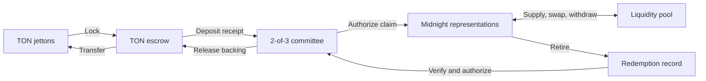

# Midnight–TON bridge

**Move tokens between TON and Midnight. Put bridged liquidity to work.**

A bidirectional bridge with a two-asset liquidity pool and TypeScript SDK. Lock jettons on TON, use their representations on Midnight, then redeem them back to TON.

[Quick start](#quick-start) · [Deployment](docs/deployment.md) · [SDK](#typescript-sdk) · [Starter app](https://github.com/AlphaCompute/midnight-ton-bridge-starter) · [Releases](https://github.com/AlphaCompute/midnight-ton-bridge/releases)

- **Existing tokens:** compatible jetton masters, verified wallet code and no issuer mint authority required.
- **Built-in liquidity:** supply assets, swap with slippage bounds and earn pool fees.
- **Operator tools:** transaction journals, signer limits, recovery, accounting checks and Prometheus metrics.

The **TON testnet ↔ Midnight preprod** deployment has completed the full deposit, claim, liquidity, swap, withdrawal and redemption flow. See [addresses](docs/evidence/testnet-deployment.json), [transaction evidence](docs/evidence/testnet-transactions.json), [accounting](docs/evidence/testnet-accounting.json) and a live [stuck-deposit recovery](docs/evidence/testnet-recovery.json), summarized in [testing and evidence](docs/testing.md#public-testnet-evidence).

## How it works



Each route connects two allowlisted TON escrows to an immutable Midnight contract. A **2-of-3 committee** authorizes claims and releases after verifying finalized chain records. Authorizations bind the route, token, recipient and amount.

Contracts use **Compact** on Midnight and **Tolk** on TON, with support for the unmodified TON reference jetton wallet. Midnight representations are unshielded. See the [architecture](docs/architecture.md), including its [scope and trust model](docs/architecture.md#scope-and-trust).

## Quick start

Requires **Node 24** (22.18+ minimum), npm, bash, curl, tar with xz support, shasum and Docker. Copy `.env.example` to `.env` and `chmod 600 .env` before adding provider tokens. See [supported platforms and toolchain details](docs/deployment.md#build-from-a-clean-checkout).

```sh
git clone git@github.com:AlphaCompute/midnight-ton-bridge.git
cd midnight-ton-bridge
bash scripts/bootstrap.sh
npm run check
npm run compile:midnight -- --proof  # Proving keys for Midnight transactions (minutes to ~30 min, several GB of RAM)
```

`bootstrap.sh` downloads the checksum-verified Compact compiler into `.tools/`, installs dependencies and compiles both chains' contracts. Proving keys are needed only for live Midnight transactions; `npm run check` builds and runs the full test suite without them.

### Run locally

```sh
docker compose up -d --wait   # local Midnight node, indexer and proof server
export BRIDGE_NETWORK=local
export BRIDGE_STATE_DIR="$PWD/.state/local-demo"
npm run deploy:midnight       # retry after a short wait if the indexer is still starting
npm run demo:local
npm run verify:local
```

The local demo exercises Midnight proofs and pool operations; the test suite covers TON execution and cross-chain authorization. See [local deployment](docs/deployment.md#deploy-to-local-test-networks) for details.

### Web app

```sh
npm run app   # http://127.0.0.1:3080
```

Bridge, track, pool and route views for the published testnet route. Midnight claim status and pool reserves need `BLOCKFROST_PROJECT_ID` in `.env` (see below).

### Deploy to testnet

Public testnet is **TON testnet + Midnight preprod**. You need a free [Blockfrost](https://blockfrost.io) project for Midnight Preprod (`BLOCKFROST_PROJECT_ID` in `.env`), about 3 test TON (`npm run fund:ton`) and tNIGHT from the [Midnight preprod faucet](https://faucet.preprod.midnight.network/).

The [deployment guide](docs/deployment.md#deploy-to-public-testnet) owns the full sequence: `prepare:testnet`, wallet initialization and DUST registration, a fixed `BRIDGE_DOMAIN`, `deploy:midnight`, `deploy:ton`, then `demo:testnet`, `demo:unrecorded`, `verify:testnet` and `check:route`. It also covers existing token masters and the gated production release procedure.

Keep `.state` private and preserve its transaction journals. Reconcile interrupted transfers using the [operator runbook](docs/operations.md#relay-and-reconciliation) before resubmitting.

## TypeScript SDK

```ts
import {BridgeClient} from '@alphaton/midnight-ton-bridge/client';

const bridge = new BridgeClient(config, transport);
// Deposit: send `payload` from `to` (the sender's own jetton wallet for this token) with
// `value` nanotons (DEPOSIT_ATTACHED_TON) attached. Never send it to the escrow directly.
const {to, value, payload} = bridge.depositRequest(
  0,                    // asset index
  tonSender,            // the TON wallet that holds the tokens
  1000n,                // integer base units
  'mn_addr_preprod1…',  // Midnight recipient (bech32m, or 32-byte hex)
);

// Redeem: retires tokens on Midnight; give the committee `request`, keep `nonce` private.
const {request, nonce} = await bridge.redeem(0, 400n, tonRecipient);
```

`config` supplies the network (`local` or `preprod`), route domain, Midnight contract address, two TON escrows, three committee public keys and, for `depositRequest`, `assets` (each token's `master`, `walletCodeBoc` and `walletCodeHash`, as in [`testnet-assets.json`](docs/evidence/testnet-assets.json)). `transport` implements `call(circuit, args): Promise<string>`. Use finalized chain readback to confirm delivery. A transfer that forwards less than `DEPOSIT_FORWARD_TON` (wallet apps often forward 1 nanoton) is not recorded and needs [committee recovery](docs/operations.md#recovery) as a refund.

| Action | SDK methods |
| --- | --- |
| Bridge into Midnight | `depositRequest` (or the low-level `depositMessage`), `claimDigest`, `claim` |
| Bridge back to TON | `redeem` (returns `nonce`, `id` and the committee `request`), `redemptionId` |
| Trade | `quote`, `swap` |
| Provide liquidity | `addLiquidity` and `removeLiquidity` take the private LP secret; `lpOwnerHash` |
| Verify token integration | `validateAssets`, `verifyAsset`, `referenceWallet` from the package root |

Install the SDK tarball from the [release bundle](https://github.com/AlphaCompute/midnight-ton-bridge/releases), or start with the [standalone notes app](https://github.com/AlphaCompute/midnight-ton-bridge-starter). The starter includes a pinned SDK package and runs with `npm ci`, `npm test` and `npm start`.

### Liquidity

TON deposits back the Midnight representations. Liquidity providers supply those representations to the pool, separately from bridge backing. The first deposit sets the reserve ratio; later deposits follow it. Swaps retain a **0.3% fee** in the pool, and withdrawals require the LP’s private secret. See [pool mechanics](docs/architecture.md#retirement-and-pools) for details.

## Operations

```sh
export BRIDGE_NETWORK=preprod   # operations run against the public testnet route
npm run check:route       # Pins, backing, circulation and journal status
npm run build && npm run monitor   # Persistent health checks and metrics
npm run reconcile:ton -- all
npm run watch -- signer SIGNER_CONFIG     # Each committee member: sign new deposits and redemptions
npm run watch -- relayer RELAYER_CONFIG   # Submit every two-signer quorum to the chains
```

The monitor serves loopback `/healthz` and `/metrics` endpoints. [Service templates and Prometheus alerts](infrastructure/monitor) support continuous monitoring. Signers and the relayer exchange signatures through a shared mailbox directory and re-verify everything they read ([automated signing and relay](docs/operations.md#automated-signing-and-relay), [service templates](infrastructure/relay)). Use the [operator runbook](docs/operations.md) for signer limits, reconciliation, [recovery](docs/operations.md#recovery) and [monitoring](docs/operations.md#monitoring).

## Documentation

| Guide | Contents |
| --- | --- |
| [Architecture](docs/architecture.md) | Contracts, trust model, authorization, representations and pool design |
| [Deployment](docs/deployment.md) | Build, local setup, public testnet, token registry and gated mainnet procedure |
| [Operations](docs/operations.md) | Custody, signing, relay, reconciliation, recovery and monitoring |
| [Testing and evidence](docs/testing.md) | Automated suite, local proofs, public testnet evidence and benchmarks |
| [Release](docs/release.md) | Handoff packaging, deliverables and sign-off, acceptance script and production roadmap |
| [Evidence](docs/evidence) | Machine-readable deployment, transaction, accounting, recovery, benchmark and build records |

## License

[Apache-2.0](LICENSE). Vendored TON reference contracts retain their [MIT license](contracts/ton/reference/LICENSE).
