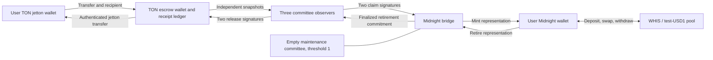

# Bridge architecture and build plan

The CLI relayer transports signed authorizations; it cannot independently mint or release. Signers trust their chain RPC/indexer observations. The new Midnight deployment has no usable maintenance authority. Pool reserves and permanently retired tokens are separately accounted within the Midnight contract.

## Scope and trust

This is a new test-asset POC, not a fork of an existing audited bridge. It implements TON escrow → Midnight wrapped representation → permanent retirement → TON release. WHIS and test-USD1 are synthetic assets. No official USD1 issuance, peg or issuer integration is implied.

One TON escrow per token authenticates its jetton wallet by deriving the address from the configured master, wallet code and escrow owner. The initial implementation supports the fixture wallet layout (balance, owner, master, wallet code, pending dictionary). It must not be pointed at a token with a different wallet implementation without an adapter and tests. A fixed three-member committee signs with Ed25519 on TON and Jubjub Schnorr on Midnight; two distinct members are required. The keys and route domain are fixed at deployment. Changing the committee requires a coordinated new deployment and reserve migration; the Midnight deployment itself is immutable (see operations).

TON receipts come from the escrow's sequential deposit ledger, not arbitrary jetton notifications observed off chain. Observers read the finalized masterchain snapshot through a trusted RPC, pin the escrow's code and configuration hashes and validate asset, amount and recipient. Each committee member must operate its own observer. RPC output is not a light-client proof. A quorum can collude to mint or withdraw; the implementation does not claim to remove that trust.

Midnight claim signatures bind the route domain, Midnight contract address, source receipt ID, asset, amount and recipient. Receipts are consumed once. Source receipt IDs incorporate TON-testnet, escrow and deposit sequence. Signatures do not expire because the source deposit remains locked until its backed token is retired. No timeout-based refund is allowed while a claim remains possible.

The representation uses Midnight unshielded token primitives. Balances, amounts, bridge correlation and recipients are public. Compact proofs prove correct execution and authorization; they do not make public TON payments anonymous. The LP withdrawal secret remains a private witness. Schnorr uses Compact's transientHash with a 248-bit little-endian challenge from upgradeFromTransient, and the prime-order Jubjub group. This fits the stable 0.31.1 compiler's scalar API. This transcript requires independent cryptographic review before valuable assets.

## Retirement and pools

Midnight redemption receives actual tokens, reduces circulating supply and records a commitment to the TON recipient and amount. Retired tokens stay permanently locked in the contract. There is no circuit to recover or spend them. AMM sends are bounded by distinct tracked pool reserves, so retired backing cannot become LP inventory. This is retirement by locking, not a claim that the protocol's total minted supply decreases.

The integrated pool supports WHIS/test-USD1 constant-product swaps, a 30-bps retained fee, LP deposits and withdrawals. LP shares are contract records keyed by a hash of an LP secret, not a transferable LP token. Bootstrap shares equal WHIS units. Minimum output/share checks protect callers; callers must calculate their acceptable limits. Excess paired deposits are donations. Division uses a witness with lower/upper quotient constraints; the witness is not trusted. Intermediate widths are explicitly bounded.

## Asynchronous TON releases

An authorized release debits locked inventory and requests a jetton transfer. State `1` means submitted, not recipient delivery. An authenticated immediate bounce restores backing and replay eligibility. The supplied fixture wallet additionally authenticates downstream bounces and reports the matching query/amount to the escrow; the escrow restores that pending release/refund. Source/recipient message matching is required before final delivery is recorded.

Malformed/cap-exceeding notified deposits receive exact sender/amount refund records. There is no arbitrary committee recovery operation. The fixture enforces minimum transfer notification gas. Direct issuer minting or unsupported token paths without notification remain unsupported inventory requiring reviewed asset-specific resolution. The supplied wallet's extra pending dictionary and failure callback make it a fixture-specific layout, not a generic production jetton adapter.

## Persistence and operations

The SQLite WAL journal keeps immutable receipt payloads, prepared transaction bytes and IDs. Compare-and-set transitions prevent concurrent workers claiming the same job. A crash after entering `sending` requires exact-transaction reconciliation. Unknown submission status is not retried with a newly built transaction. Source observations may be re-read safely using the same receipt identity. Destination adapters must return finalized outcomes based on transaction evidence, never health checks.

## Implementation order and validation gates

1. Research and pin compatible compiler/runtime/protocol versions.
2. Compile both contracts and execute TON TVM and compiled Midnight runtime tests.
3. Test adverse authorization, replay, slippage, arithmetic, cross-instance binding and durable restart behavior.
4. Exercise a combined escrow→claim→retire→release demonstration with synthetic assets.
5. Generate proving keys and validate actual proof-backed transactions against the local Midnight node/indexer.
6. Package the SDK, starter, deployment configuration and recovery documentation; reproduce from a clean install.
7. Run independent audit, accepted public-testnet end-to-end exercise, funding/operator handover and Foundation acceptance before any real-value use.

No successful local test substitutes for the later gates. Validation results and unresolved items belong in `docs/validation.md`.

## Primary research

- [TON Tolk contracts](https://docs.ton.org/contracts/overview): language/tooling. The implementation uses the official Tolk WASM compiler and Sandbox directly for programmatic reproducibility.
- [TON jetton processing](https://docs.ton.org/applications/payments/jettons): authenticate master/wallet and account for message lifecycle.
- [TON Sandbox](https://docs.ton.org/contracts/blueprint/testing/overview): local TVM emulation is separate from public-network acceptance.
- [Midnight unshielded tokens](https://docs.midnight.network/tokens/unshielded-token): token primitives and compatible stable toolchain.
- [Compact language](https://docs.midnight.network/compact/reference/compact-reference): witness disclosure and integer/cast behavior.
- [Compact source](https://github.com/LFDT-Minokawa/compact): compiler and cryptography API cross-checks. Documentation describing newer Secp256k1 helpers did not match the stable compiler; those helpers are not used.
- [Midnight local network](https://github.com/midnightntwrk/midnight-local-dev): isolated local network service configuration. The local indexer example configuration is derived from this project.

The private contract analysis is in the ignored local `output/` directory and is intentionally excluded from software distribution.
