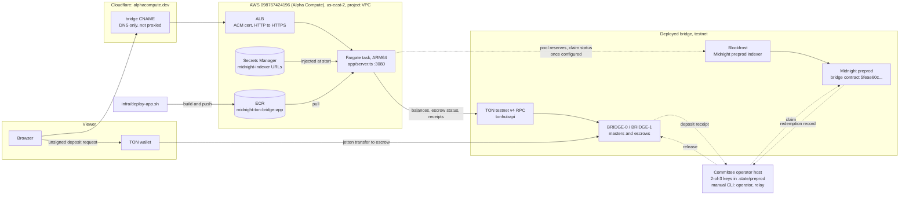

# Web app hosting

Hosting for the bridge web app (`app/server.ts`) at **https://bridge.alphacompute.dev**: one Fargate task behind an ALB. The app serves the UI and a read-only `/api` that queries TON testnet and the Midnight indexer. It holds no keys and submits nothing; deposits are signed in the user's own TON wallet.



Dashed edges are not automated. A deposit only becomes claimable on Midnight, and a redemption only releases on TON, after two committee signers attest and someone submits with `npm run relay`. See [operations](../docs/operations.md). The Blockfrost edge stays dashed until the indexer secret is filled in.

## Layout

| Piece | Where | Managed by |
| --- | --- | --- |
| VPC `midnight-ton-bridge` (10.201.0.0/16, two public subnets, no NAT) | us-east-2 | Terraform in `terraform/` |
| ALB, target group, ACM certificate, security groups | us-east-2, project VPC public subnets | Terraform |
| ECS cluster, service, task definition, log group `/ecs/midnight-ton-bridge` | us-east-2 | Terraform |
| ECR repository `midnight-ton-bridge-app` | us-east-2 | Terraform; images pushed by `deploy-app.sh` |
| Secret `midnight-ton-bridge/midnight-indexer` | us-east-2 | Terraform creates it; the value is set by hand |
| `bridge` CNAME and ACM validation CNAME | Cloudflare zone `alphacompute.dev` | Cloudflare dashboard or API, outside Terraform |
| Terraform state | `s3://alpha-compute-tfstate-098767424196/midnight-ton-bridge/terraform.tfstate`, locked with an S3 lockfile | Shared state bucket from `alpha-infra` |

The task's security group admits only the ALB on port 3080 and allows outbound HTTPS only. The ALB health check requests `/`, a static page that calls neither TON nor Midnight, so an upstream outage degrades the status chips instead of failing the service. It cannot use `/api/*`: the ALB sends the task IP as the Host header, and the server answers the API only for the hosts in `APP_ALLOWED_HOSTS`, which the task definition sets to the public hostname. The HTTPS listener adds an HSTS header, and the VPC default security group is stripped of rules.

AWS resources carry `Project=midnight-ton-bridge`, `Environment=prod`, `Owner`, `ManagedBy=Terraform` and `Backup=none` through provider `default_tags`, and the service sets `propagate_tags = "SERVICE"` so running tasks carry them too. The `alphacompute.dev` plan allows no DNS record tags, so the two Cloudflare records carry `Project=midnight-ton-bridge` in their comment instead.

## Deploy the current checkout

Requires Docker, the AWS CLI with credentials for the Alpha Compute account (098767424196, for example `AWS_PROFILE=alpha`) and Terraform outputs from `terraform/`.

```sh
infra/deploy-app.sh
```

It builds `infra/app.Dockerfile` for linux/arm64 (the image runs `scripts/bootstrap.sh`, so the Compact toolchain pins are the repository's own), pushes `<commit>` and `latest` tags, forces a new ECS deployment and waits until the service is stable. A failed deployment rolls back through the ECS circuit breaker.

## Configure the Midnight indexer

Midnight retired its hosted preprod indexer on 2026-10-09; preprod is now served by Blockfrost. Until the secret is filled, the Midnight chip, pool reserves and claim status show "indexer not configured" while the TON side works. With a Blockfrost project ID that starts with `nightpreprod`:

```sh
read -rs PID
aws secretsmanager put-secret-value --region us-east-2 \
  --secret-id midnight-ton-bridge/midnight-indexer \
  --secret-string "$(jq -nc --arg p "$PID" '{
    MIDNIGHT_INDEXER_URL: "https://midnight-preprod.blockfrost.io/api/v0?project_id=\($p)",
    MIDNIGHT_INDEXER_WS:  "wss://midnight-preprod.blockfrost.io/api/v0/ws?project_id=\($p)"}')"
aws ecs update-service --region us-east-2 --cluster midnight-ton-bridge-cluster \
  --service midnight-ton-bridge-app --force-new-deployment
```

Setting both URLs explicitly works on every commit. From `b82b682` the server also derives a correct WebSocket URL from `MIDNIGHT_INDEXER_URL` (keeping the query string) and accepts `BLOCKFROST_PROJECT_ID` on its own; this stack keeps the two-URL secret so older images still work.

## Change the infrastructure

```sh
cd infra/terraform
terraform init
terraform fmt && terraform validate && terraform plan
terraform apply
```

If the certificate is ever replaced, `terraform output acm_validation_records` lists the CNAME to create in Cloudflare before the apply can finish. If the ALB is replaced, point the `bridge` CNAME at the new `alb_dns_name` output.
